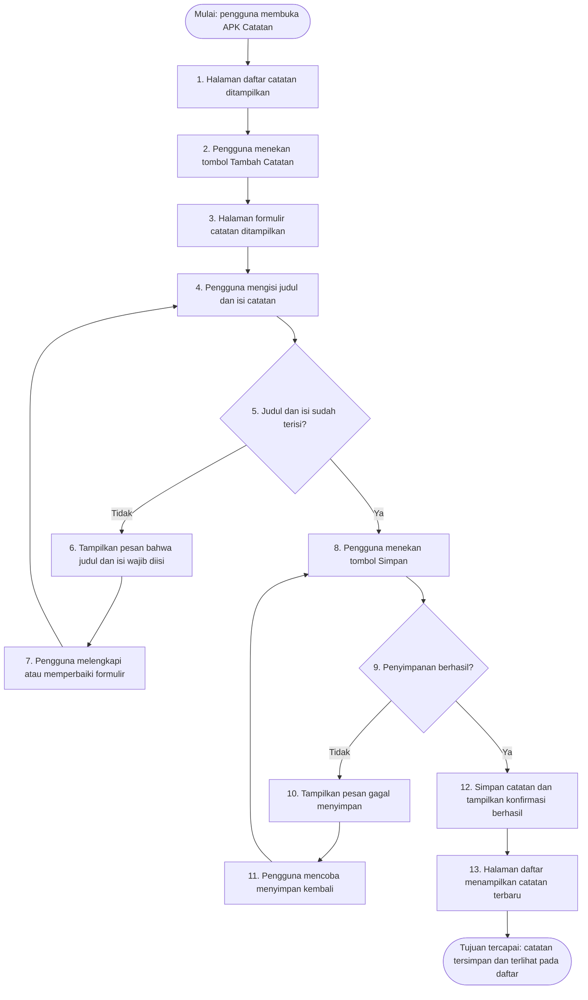

# TUGAS 4 — DOKUMEN KEBUTUHAN DAN USER FLOW

**Nama aplikasi:** APK Catatan  
**Domain Sistem Informasi:** Pencatatan pribadi dan aktivitas mahasiswa

## 1. Deskripsi Aplikasi

APK Catatan merupakan aplikasi mobile pada domain pencatatan pribadi dan aktivitas mahasiswa yang membantu pengguna menyimpan serta mengelola informasi penting, seperti catatan perkuliahan, tugas, jadwal, ide, dan daftar kegiatan. Masalah yang dihadapi pengguna adalah catatan sering tersebar di kertas atau beberapa aplikasi, sehingga berisiko hilang, sulit ditemukan kembali, dan terlupakan ketika dibutuhkan. Solusi berbentuk aplikasi mobile dipilih karena dapat diakses melalui telepon genggam yang biasa dibawa pengguna, mendukung pencatatan saat bepergian atau di sela kegiatan, serta menyediakan tampilan dan interaksi yang sesuai untuk penggunaan layar sentuh.

## 2. Persona Pengguna

### Persona 1 — Mahasiswa aktif (persona utama)

| Komponen | Deskripsi |
|---|---|
| **Nama dan peran** | Raka — Mahasiswa aktif yang menggunakan aplikasi untuk mencatat materi kuliah, tugas, jadwal, dan ide. Nama ini merupakan persona fiktif, bukan individu nyata. |
| **Tujuan** | Menyimpan catatan perkuliahan dan kegiatan dalam satu tempat serta menemukan kembali catatan saat diperlukan. |
| **Kendala** | Jadwal kuliah dan tugas padat; catatan dapat tersebar di buku, kertas, atau aplikasi berbeda; terkadang lupa lokasi catatan yang dicari. |
| **Perangkat dan konteks** | Menggunakan smartphone Android ketika di kelas, perpustakaan, rumah, atau saat perjalanan; aplikasi dibuka ketika perlu mencatat atau membaca informasi. |
| **Frekuensi penggunaan** | Setiap hari, beberapa kali dalam sehari, terutama saat kegiatan perkuliahan dan mengerjakan tugas. |

### Persona 2 — Pengguna umum

| Komponen | Deskripsi |
|---|---|
| **Nama dan peran** | Dini — Pengguna umum yang mencatat kebutuhan pribadi, daftar belanja, pengingat sederhana, dan ide. Nama ini merupakan persona fiktif, bukan individu nyata. |
| **Tujuan** | Menyimpan informasi sehari-hari agar tidak terlupakan dan dapat dibaca kembali dengan praktis. |
| **Kendala** | Tidak selalu membawa buku catatan; catatan singkat mudah tertimbun atau tercampur dengan informasi lain. |
| **Perangkat dan konteks** | Menggunakan smartphone ketika berada di rumah, tempat kerja, atau toko; aplikasi digunakan ketika muncul informasi yang perlu dicatat. |
| **Frekuensi penggunaan** | Beberapa kali dalam seminggu, meningkat ketika memiliki banyak kegiatan atau kebutuhan yang harus dicatat. |

## 3. Kebutuhan Fungsional

| ID | Aktor | Pernyataan kebutuhan fungsional |
|---|---|---|
| **F-01** | Pengguna | Pengguna dapat membuat catatan baru dengan mengisi judul dan isi agar informasi penting tersimpan di aplikasi. |
| **F-02** | Pengguna | Pengguna dapat melihat daftar catatan yang tersimpan agar mengetahui catatan yang pernah dibuat. |
| **F-03** | Pengguna | Pengguna dapat membuka detail sebuah catatan agar dapat membaca seluruh isi catatan. |
| **F-04** | Pengguna | Pengguna dapat mengubah judul atau isi catatan agar informasi yang tersimpan tetap sesuai dengan kondisi terbaru. |
| **F-05** | Pengguna | Pengguna dapat menghapus catatan yang dipilih setelah memberikan konfirmasi agar catatan yang tidak diperlukan tidak lagi muncul dalam daftar. |
| **F-06** | Pengguna | Pengguna dapat mencari catatan berdasarkan kata pada judul agar catatan tertentu lebih mudah ditemukan. |
| **F-07** | Pengguna | Pengguna dapat mengelompokkan catatan berdasarkan kategori agar catatan sejenis dapat ditinjau bersama. |
| **F-08** | Pengguna | Pengguna dapat membagikan isi catatan melalui fitur berbagi perangkat agar informasi dapat dikirim kepada orang lain. |
| **F-09** | Pengguna | Pengguna dapat menyinkronkan catatan antarperangkat agar catatan yang dibuat pada satu perangkat tersedia pada perangkat lain. |

## 4. Kebutuhan Nonfungsional

| ID | Kategori | Rumusan kebutuhan dan kriteria terukur |
|---|---|---|
| **NF-01** | Kegunaan | Pengguna harus dapat menyelesaikan proses membuat catatan baru dari halaman utama dalam maksimal **3 halaman/tampilan**: halaman daftar, halaman formulir, dan konfirmasi/hasil penyimpanan. |
| **NF-02** | Kinerja | Pada perangkat dengan koneksi dan kondisi operasi normal, **95%** proses membuka daftar catatan, membuka detail, menyimpan, dan mencari catatan harus menampilkan hasil dalam waktu maksimal **2 detik**. |
| **NF-03** | Keamanan | Sebelum penghapusan permanen, aplikasi harus menampilkan dialog konfirmasi yang menyediakan pilihan **hapus** dan **batal**; catatan tidak boleh terhapus jika pengguna memilih batal. |
| **NF-04** | Kompatibilitas | Tampilan utama harus tetap dapat digunakan pada perangkat Android dengan lebar layar minimal **360 dp**, tanpa teks atau tombol utama terpotong. |

## 5. Prioritas Kebutuhan — MoSCoW

Prioritas diberikan pada kebutuhan fungsional F-01 sampai F-09. Jumlah kebutuhan kategori **Must have adalah 5**, sesuai batas tugas.

| Prioritas | ID kebutuhan | Alasan |
|---|---|---|
| **Must have** | F-01 — Membuat catatan | Fungsi inti aplikasi; persona mahasiswa membutuhkan tempat untuk segera menyimpan materi, tugas, dan ide. |
| **Must have** | F-02 — Melihat daftar catatan | Pengguna perlu melihat catatan yang telah dibuat agar dapat mengakses kembali informasi tersimpan. |
| **Must have** | F-03 — Melihat detail catatan | Tujuan utama pencatatan adalah agar isi informasi dapat dibaca kembali secara utuh. |
| **Must have** | F-04 — Mengubah catatan | Pengguna perlu memperbaiki atau memperbarui informasi ketika ada perubahan materi, jadwal, atau isi catatan. |
| **Must have** | F-05 — Menghapus catatan | Pengguna perlu mengelola catatan yang sudah tidak relevan; konfirmasi penghapusan mengurangi risiko salah hapus. |
| **Should have** | F-06 — Mencari catatan | Pencarian membantu persona mahasiswa menemukan catatan ketika jumlah catatan bertambah, tetapi aplikasi masih dapat menjalankan fungsi dasar tanpa pencarian. |
| **Should have** | F-07 — Mengelompokkan kategori | Kategori membantu memisahkan catatan kuliah dan pribadi, namun dapat dikembangkan setelah fungsi pengelolaan catatan inti tersedia. |
| **Could have** | F-08 — Membagikan catatan | Berbagi dapat menambah manfaat kolaborasi, tetapi bukan kebutuhan utama untuk pencatatan pribadi pada versi awal. |
| **Won't have (untuk versi ini)** | F-09 — Sinkronisasi antarperangkat | Ditunda karena membutuhkan pengelolaan akun, layanan sinkronisasi, dan perlindungan data tambahan; kebutuhan ini dapat dievaluasi pada pengembangan berikutnya. |

## 6. User Flow

### 6.1 Identitas Alur

| Aspek | Isi |
|---|---|
| **Nama alur** | Membuat dan menyimpan catatan baru |
| **Aktor** | Raka — Mahasiswa aktif (persona utama) |
| **Tujuan alur** | Catatan baru berhasil tersimpan dan tampil pada daftar catatan. |

### 6.2 Diagram User Flow

Diagram berikut menggambarkan satu tujuan pengguna. Terdapat lebih dari 8 langkah dan 2 titik keputusan. Setiap cabang gagal memiliki tindak lanjut dan jalur kembali.

### 6.3 Daftar Langkah

| No. | Jenis | Langkah/Halaman | Bila gagal |
|---:|---|---|---|
| 1 | Mulai | Pengguna membuka APK Catatan. | — |
| 2 | Halaman | Halaman daftar catatan ditampilkan. | Jika daftar belum memiliki catatan, tampilkan keadaan kosong dan tombol tambah. |
| 3 | Aksi | Pengguna menekan tombol **Tambah Catatan**. | Jika tombol tidak dapat digunakan, pengguna tetap berada di halaman daftar. |
| 4 | Halaman | Halaman formulir catatan ditampilkan. | Jika formulir tidak tampil, pengguna dapat kembali ke halaman daftar dan mencoba lagi. |
| 5 | Aksi | Pengguna mengisi judul dan isi catatan. | — |
| 6 | Keputusan 1 | Sistem memeriksa apakah judul dan isi sudah terisi. | Jika tidak, tampilkan pesan validasi dan arahkan pengguna melengkapi formulir. |
| 7 | Aksi | Pengguna melengkapi atau memperbaiki isian. | Jika masih kosong, validasi dilakukan kembali. |
| 8 | Aksi | Pengguna menekan tombol **Simpan**. | — |
| 9 | Keputusan 2 | Sistem memeriksa apakah proses penyimpanan berhasil. | Jika gagal, tampilkan pesan gagal dan sediakan tindakan mencoba kembali. |
| 10 | Penanganan gagal | Pengguna menekan **Coba Lagi** untuk mengulangi penyimpanan. | Jika tetap gagal, pengguna dapat tetap berada di formulir dan tidak kehilangan isian selama halaman masih aktif. |
| 11 | Hasil | Sistem menyimpan catatan dan menampilkan konfirmasi berhasil. | — |
| 12 | Halaman | Halaman daftar menampilkan catatan terbaru. | Jika catatan belum terlihat, pengguna dapat memuat ulang daftar. |
| 13 | Tujuan | Catatan baru tersimpan dan dapat dibuka dari daftar. | — |

## 7. Pemetaan Kebutuhan Fungsional ke Halaman dan Widget

Widget berikut merupakan **rencana awal** berdasarkan materi layout/widget Pertemuan 3. Pemilihan widget dapat diperhalus pada Pertemuan 5.

| ID kebutuhan | Halaman yang memenuhi | Widget yang direncanakan |
|---|---|---|
| F-01 — Membuat catatan | Form Tambah Catatan | `Scaffold`, `AppBar`, `Padding`, `Column`, `TextField`, `ElevatedButton` |
| F-02 — Melihat daftar catatan | Beranda/Daftar Catatan | `Scaffold`, `AppBar`, `ListView.builder`, `Card`, `ListTile`, `FloatingActionButton` |
| F-03 — Melihat detail catatan | Detail Catatan | `Scaffold`, `AppBar`, `Padding`, `Column`, `Text` |
| F-04 — Mengubah catatan | Form Edit Catatan | `Scaffold`, `AppBar`, `Padding`, `Column`, `TextField`, `ElevatedButton` |
| F-05 — Menghapus catatan | Daftar Catatan atau Detail Catatan | `IconButton`, `AlertDialog`, `TextButton` |
| F-06 — Mencari catatan | Beranda/Daftar Catatan | `AppBar`, `TextField` atau `SearchBar`, `ListView.builder`, `Card` |
| F-07 — Mengelompokkan kategori | Form Tambah/Edit dan Daftar Catatan | `DropdownButtonFormField`, `Row`, `ChoiceChip`, `ListView.builder` |
| F-08 — Membagikan catatan | Detail Catatan | `IconButton`, `Column`, `Text` |
| F-09 — Sinkronisasi antarperangkat (ditunda) | Pengaturan/Sinkronisasi | Belum direncanakan untuk versi ini; rancangan widget ditentukan ketika kebutuhan diaktifkan kembali. |

## 8. Catatan Asumsi dan Batasan

1. APK Catatan pada tugas ini berfokus pada pengelolaan catatan pribadi, bukan aplikasi kolaborasi dokumen.
2. Persona merupakan gambaran pengguna representatif untuk membantu analisis kebutuhan, bukan hasil identifikasi individu tertentu.
3. Sinkronisasi antarperangkat ditetapkan sebagai *Won't have* untuk versi awal dan tidak termasuk cakupan implementasi saat ini.
4. Diagram user flow berfokus pada satu tujuan, yaitu membuat dan menyimpan catatan baru.
