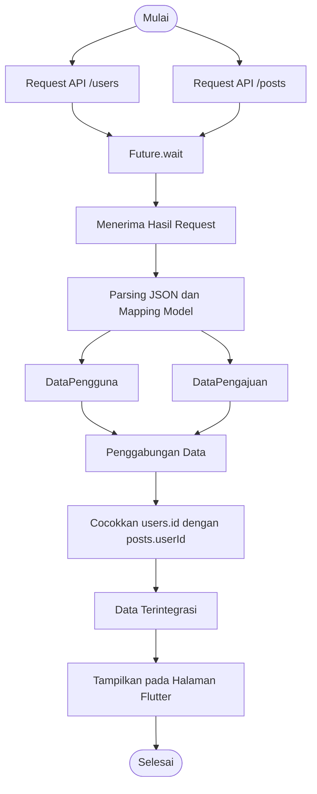

# Tugas 10 – Integrasi Data dan Proses Bisnis SIPORA

## Identitas

- **Nama:** Intan Kartika
- **NIM:** 230660221018

## Deskripsi

Project ini merupakan pengembangan SIPORA untuk menerapkan integrasi data dari beberapa endpoint API. Data pengguna dan data posting simulasi diambil, diolah, kemudian digabungkan agar dapat ditampilkan dalam satu halaman Flutter.

## Endpoint API

API menggunakan layanan [JSONPlaceholder](https://jsonplaceholder.typicode.com/).

| Endpoint | Keterangan |
|---|---|
| `/users` | Mengambil data pengguna |
| `/posts` | Mengambil data posting simulasi |

## Model dan Pemetaan Data

Implementasi menggunakan dua model Dart:

- **DataPengguna:** memetakan `id`, `name`, dan `email` dari endpoint `/users`.
- **DataPengajuan:** memetakan `id`, `userId`, `title`, dan `body` dari endpoint `/posts`.

Penggabungan dilakukan dengan mencocokkan `users.id` dan `posts.userId`. Nama pengguna hasil pencocokan disimpan pada properti `namaPengguna`.

## Alur Integrasi API

Proses integrasi dimulai dengan mengambil data dari dua endpoint secara bersamaan menggunakan `Future.wait`. Selanjutnya, respons JSON dipetakan ke model Dart dan digabungkan berdasarkan identifier.



## Fitur

- Mengambil data dari dua endpoint API.
- Mengubah respons JSON menjadi model Dart menggunakan `fromJson`.
- Menggabungkan data berdasarkan identifier.
- Memisahkan model, service, dan tampilan aplikasi.
- Menampilkan kondisi loading, berhasil, kosong, dan error.
- Menyediakan fitur muat ulang dan coba lagi.

## Struktur Project

```text
lib/
├── main.dart
├── models/
│   ├── data-pengguna.dart
│   └── data-pengajuan.dart
└── services/
    └── integrasi-api.dart

pubspec.yaml
README.md
refleksi.md
```

## Cara Menjalankan

1. Pastikan Flutter SDK sudah terpasang.
2. Buka terminal pada folder project.
3. Jalankan perintah berikut:

```bash
flutter pub get
flutter run -d chrome
```

## Keterbatasan API

Data yang digunakan merupakan data simulasi dari JSONPlaceholder, bukan data pengajuan mahasiswa sebenarnya. Endpoint `/posts` digunakan sebagai representasi data pengajuan untuk keperluan pembelajaran integrasi API. Oleh karena itu, informasi yang ditampilkan tidak mencerminkan pengajuan akademik yang benar-benar diproses oleh SIPORA.