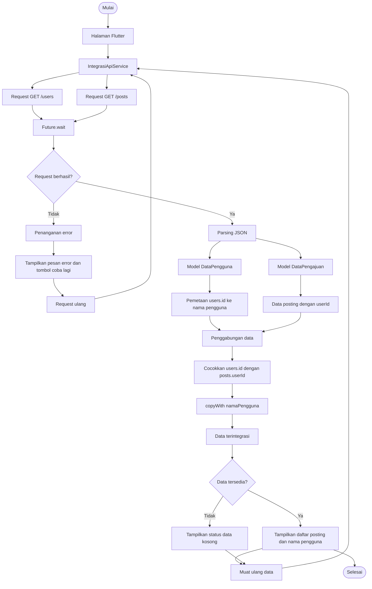

# Diagram Integrasi Data dan Proses Bisnis SIPORA — Tugas 10

## Deskripsi

Integrasi data pada Tugas 10 dilakukan dengan mengambil data dari dua endpoint REST API JSONPlaceholder, yaitu `/users` dan `/posts`. Kedua data tersebut digunakan untuk menampilkan posting simulasi beserta nama pengguna yang terkait.

Pengambilan data dilakukan secara asynchronous menggunakan `Future.wait`, kemudian respons JSON dipetakan ke model Dart. Data digabungkan dengan mencocokkan `users.id` dengan `posts.userId`, sehingga setiap data posting dapat menampilkan nama pengguna yang sesuai.

## Diagram Alur Integrasi



## Pemetaan Endpoint

| Endpoint | Data yang Diambil | Model |
|---|---|---|
| `GET /users` | `id`, `name`, `email` | `DataPengguna` |
| `GET /posts` | `id`, `userId`, `title`, `body` | `DataPengajuan` |

## Proses Penggabungan Data

1. Service mengambil data pengguna dari endpoint `/users`.
2. Service mengambil data posting simulasi dari endpoint `/posts`.
3. Kedua request dijalankan secara bersamaan menggunakan `Future.wait`.
4. Respons JSON dipetakan ke model `DataPengguna` dan `DataPengajuan` menggunakan `fromJson`.
5. Data pengguna disusun dalam pemetaan berdasarkan `id`.
6. Setiap data posting dicocokkan berdasarkan `userId`.
7. Nama pengguna yang sesuai dimasukkan ke data posting melalui `copyWith`.
8. Data yang telah terintegrasi dikembalikan ke halaman Flutter untuk ditampilkan.

## Komponen yang Terlibat

- **Halaman Flutter:** Mengelola tampilan, pemuatan data, refresh, serta kondisi loading, data, dan error.
- **IntegrasiApiService:** Menangani request HTTP, pemeriksaan status response, parsing JSON, dan penggabungan data.
- **DataPengguna:** Model untuk memetakan data pengguna dari endpoint `/users`.
- **DataPengajuan:** Model untuk memetakan data posting simulasi dari endpoint `/posts` serta menyimpan nama pengguna hasil integrasi.

## Keterbatasan

API JSONPlaceholder digunakan sebagai sumber data simulasi. Endpoint `/posts` tidak merepresentasikan pengajuan akademik SIPORA yang sebenarnya. Penggabungan data dilakukan untuk mempraktikkan integrasi endpoint, pemetaan model, dan proses penyajian data dalam aplikasi Flutter.
```
