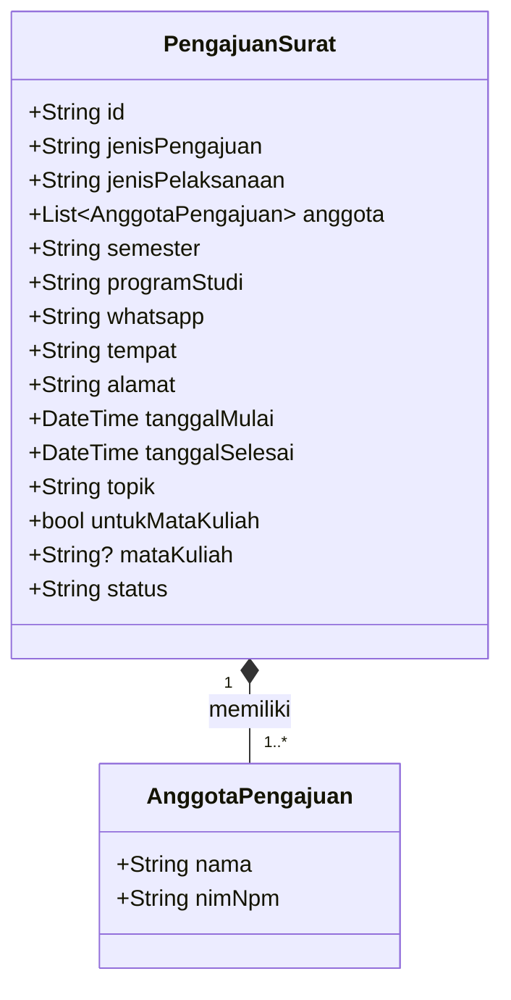

# Model Data SIPORA

## 1. Tujuan Model Data

Model data SIPORA dirancang untuk merepresentasikan informasi pengajuan surat observasi dan riset akademik yang diisi oleh mahasiswa. Pada Tugas 7, model ini digunakan sebagai dasar pengelolaan data lokal melalui operasi *Create, Read, Update,* dan *Delete* (CRUD).

Perancangan model data mengacu pada kebutuhan fungsional dalam `dokumen-kebutuhan.md` pada Tugas 4 serta struktur formulir pada `form-interaksi.dart` dalam Tugas 6. Dengan demikian, data yang dikelola tetap berkaitan dengan alur pengajuan yang telah dirancang sebelumnya.

Pada tahap ini, data disimpan dalam memori aplikasi dan belum menggunakan basis data maupun layanan server. Oleh karena itu, pengelolaan data lokal pada Tugas 7 merupakan simulasi awal dari proses pengajuan SIPORA, bukan pengiriman pengajuan secara nyata kepada petugas fakultas.

## 2. Entitas Data

Model data SIPORA terdiri atas dua entitas, yaitu `PengajuanSurat` dan `AnggotaPengajuan`.

### 2.1 Entitas PengajuanSurat

`PengajuanSurat` merupakan entitas utama yang menyimpan informasi suatu pengajuan surat. Setiap pengajuan memiliki ID unik yang digunakan untuk mengidentifikasi data ketika ditampilkan, diperbarui, atau dihapus.

| No. | Nama Field | Tipe Data Dart | Sumber Data | Keterangan |
|---:|---|---|---|---|
| 1 | `id` | `String` | Sistem | Identitas unik setiap pengajuan yang dibuat oleh aplikasi. |
| 2 | `jenisPengajuan` | `String` | Form | Jenis surat yang dipilih, seperti `Observasi` atau `Penelitian Skripsi`. |
| 3 | `jenisPelaksanaan` | `String` | Form | Jenis pelaksanaan, yaitu `Individu` atau `Kelompok`, sesuai pilihan pada formulir. |
| 4 | `anggota` | `List<AnggotaPengajuan>` | Form | Daftar mahasiswa yang terlibat dalam pengajuan, termasuk mahasiswa pengaju dan anggota kelompok jika ada. |
| 5 | `semester` | `String` | Form | Semester mahasiswa pengaju. |
| 6 | `programStudi` | `String` | Form | Program studi mahasiswa pengaju. |
| 7 | `whatsapp` | `String` | Form | Nomor WhatsApp yang dicantumkan untuk keperluan komunikasi. |
| 8 | `tempat` | `String` | Form | Nama instansi atau tempat pelaksanaan observasi maupun penelitian. |
| 9 | `alamat` | `String` | Form | Alamat tempat pelaksanaan kegiatan. |
| 10 | `tanggalMulai` | `DateTime` | Form | Tanggal mulai kegiatan yang diajukan. |
| 11 | `tanggalSelesai` | `DateTime` | Form | Tanggal selesai kegiatan yang diajukan. |
| 12 | `topik` | `String` | Form | Topik atau tujuan kegiatan observasi maupun penelitian. |
| 13 | `untukMataKuliah` | `bool` | Form | Penanda apakah pengajuan observasi digunakan untuk keperluan mata kuliah. |
| 14 | `mataKuliah` | `String?` | Form | Nama mata kuliah apabila pengajuan observasi berkaitan dengan mata kuliah. Bernilai `null` jika tidak relevan atau tidak diisi. |
| 15 | `status` | `String` | Sistem | Status awal pengajuan yang ditetapkan aplikasi, yaitu `Diproses`. |

Field `anggota` menggunakan daftar objek `AnggotaPengajuan` agar data setiap mahasiswa tersimpan sebagai satu kesatuan. Pendekatan ini memudahkan aplikasi menampilkan informasi mahasiswa secara konsisten, baik untuk pengajuan individu maupun kelompok.

Field `untukMataKuliah` dan `mataKuliah` mengikuti kondisi pada formulir Tugas 6. Informasi mata kuliah hanya relevan ketika pengajuan observasi digunakan untuk keperluan mata kuliah. Dengan demikian, tidak semua pengajuan harus memiliki nilai `mataKuliah`.

### 2.2 Entitas AnggotaPengajuan

`AnggotaPengajuan` merupakan entitas pendukung yang menyimpan identitas setiap mahasiswa yang terlibat dalam suatu pengajuan.

| No. | Nama Field | Tipe Data Dart | Sumber Data | Keterangan |
|---:|---|---|---|---|
| 1 | `nama` | `String` | Form | Nama mahasiswa yang terlibat dalam pengajuan. |
| 2 | `nimNpm` | `String` | Form | Nomor identitas mahasiswa berupa NIM atau NPM. |

NIM/NPM menggunakan tipe `String`, bukan `int`, karena nomor identitas bukan nilai untuk operasi aritmetika dan dapat mengandung angka nol di awal. Data nama dan NIM/NPM disimpan bersama dalam satu objek agar identitas setiap anggota tidak tertukar.

## 3. Relasi Antarentitas

Satu objek `PengajuanSurat` memiliki satu atau lebih objek `AnggotaPengajuan` sesuai jenis pelaksanaannya. Pada pengajuan individu, daftar anggota berisi mahasiswa pengaju. Pada pengajuan kelompok, daftar anggota memuat mahasiswa pengaju dan anggota kelompok lainnya.

Relasi tersebut dapat digambarkan sebagai berikut:

Relasi tersebut menggambarkan struktur objek dalam aplikasi, bukan relasi tabel basis data. Implementasi Tugas 7 menggunakan objek Dart dan daftar lokal dalam memori.

## 4. Pemetaan Field terhadap Kebutuhan Fungsional

Pemetaan berikut mengacu pada ID kebutuhan fungsional yang telah ditetapkan dalam dokumen Tugas 4.

| ID Kebutuhan | Kebutuhan Fungsional | Field atau Data Terkait | Penerapan pada Tugas 7 |
|---|---|---|---|
| F-01 | Mahasiswa dapat memilih jenis surat yang akan diajukan. | `jenisPengajuan` | Jenis pengajuan dicatat dalam objek setelah dipilih melalui formulir. |
| F-02 | Mahasiswa dapat mengisi data pengajuan surat. | `anggota`, `semester`, `programStudi`, `whatsapp`, `tempat`, `alamat`, `tanggalMulai`, `tanggalSelesai`, `topik`, `untukMataKuliah`, `mataKuliah`, dan `jenisPelaksanaan` | Data dari formulir direpresentasikan dalam model pengajuan. |
| F-04 | Mahasiswa dapat mengirim pengajuan setelah data dan dokumen pendukung dinyatakan lengkap. | Seluruh field pengajuan dan `id` | Dalam lingkup Tugas 7, data yang telah dikonfirmasi dapat ditambahkan ke daftar lokal. Proses ini belum merupakan pengiriman ke server atau petugas fakultas. |
| F-05 | Mahasiswa dapat melihat status pengajuan. | `id`, `jenisPengajuan`, `tempat`, dan `status` | Daftar lokal menampilkan informasi ringkas pengajuan dan status awalnya. Pemantauan status secara aktual belum tersedia. |

### Kebutuhan yang Belum Diimplementasikan

Beberapa kebutuhan Tugas 4 belum dapat direpresentasikan sebagai fungsi yang berjalan penuh pada model lokal ini.

| ID Kebutuhan | Kebutuhan | Batasan pada Tugas 7 |
|---|---|---|
| F-03 | Mengunggah dokumen pendukung. | Formulir Tugas 6 yang diperiksa belum mengimplementasikan pengunggahan dokumen. Karena itu, model ini belum memiliki field dokumen yang dapat digunakan. |
| F-06 | Memperoleh surat yang telah selesai. | Belum ada berkas surat hasil penerbitan yang disimpan atau dapat diunduh. |
| F-07 | Petugas melihat daftar pengajuan mahasiswa. | Daftar yang dikembangkan pada Tugas 7 merupakan daftar lokal di sisi aplikasi mahasiswa, bukan daftar bersama milik petugas. |
| F-08 | Petugas memeriksa data pengajuan. | Belum tersedia halaman dan mekanisme pemeriksaan khusus petugas. |
| F-09 | Petugas memeriksa dokumen pendukung. | Belum tersedia data dokumen pendukung yang dapat diperiksa. |
| F-10 | Petugas memperbarui status pengajuan. | Status pada model lokal belum terhubung dengan tindakan petugas atau server. |
| F-11 | Petugas mengunggah surat yang telah selesai. | Belum tersedia proses pengunggahan surat hasil penyelesaian. |

Pemetaan ini menjaga kesesuaian antara kebutuhan yang direncanakan pada Tugas 4 dan kemampuan prototipe yang benar-benar dikembangkan sampai Tugas 7. Kebutuhan yang belum diimplementasikan tetap dicatat sebagai ruang pengembangan berikutnya, bukan dianggap sudah terpenuhi.

## 5. Aturan Pengelolaan Data

Agar data konsisten selama operasi CRUD, aturan berikut diterapkan pada model dan logika aplikasi:

1. **ID unik.** Setiap pengajuan memperoleh ID yang dibuat oleh sistem. ID digunakan sebagai identitas utama saat mencari, memperbarui, dan menghapus data. Indeks daftar tidak digunakan sebagai identitas pengajuan.
2. **Field model tidak berubah langsung.** Field pada model `PengajuanSurat` dan `AnggotaPengajuan` dirancang menggunakan `final`. Ketika pengajuan diperbarui, aplikasi membentuk objek pengganti dengan ID yang sama.
3. **Validasi data.** Data yang diterima model berasal dari formulir yang telah melewati validasi. Tanggal selesai tidak boleh mendahului tanggal mulai.
4. **Status awal.** Pengajuan yang baru ditambahkan memperoleh status `Diproses` agar selaras dengan label status yang digunakan pada contoh daftar SIPORA sebelumnya. Status tersebut hanya menggambarkan keadaan awal pada simulasi lokal.
5. **Keterkaitan anggota.** Setiap anggota menyimpan nama dan NIM/NPM dalam satu objek. Perubahan daftar anggota dilakukan sebagai bagian dari perubahan objek pengajuan yang bersangkutan.
6. **Batas penyimpanan.** Data disimpan dalam daftar di memori aplikasi. Data dapat hilang ketika aplikasi dimulai ulang karena persistensi belum diimplementasikan.

## 6. Hubungan dengan Implementasi CRUD Lokal

Model data menjadi dasar untuk empat operasi yang akan dikembangkan pada `crud-lokal.dart`.

| Operasi | Penerapan | Hasil yang Diharapkan |
|---|---|---|
| Create | Membentuk objek `PengajuanSurat` dari hasil formulir, menetapkan ID unik dan status awal, lalu menambahkannya ke daftar menggunakan `setState()`. | Pengajuan baru muncul pada daftar. |
| Read | Membaca daftar objek melalui `ListView.builder`. | Informasi pengajuan ditampilkan secara dinamis sesuai data yang tersedia. |
| Update | Mencari pengajuan menggunakan ID, kemudian mengganti objek lama dengan objek baru yang memiliki ID yang sama. | Perubahan hanya diterapkan pada pengajuan yang dipilih. |
| Delete | Menampilkan dialog konfirmasi, kemudian menghapus objek berdasarkan ID menggunakan `removeWhere()` setelah pengguna menyetujui. | Pengajuan yang dipilih dihapus dari daftar lokal. |

Operasi Update dan Delete pada Tugas 7 merupakan kemampuan pengelolaan data dalam prototipe lokal. Keduanya tidak dimaksudkan sebagai pengganti proses pemeriksaan atau perubahan status resmi yang dilakukan oleh petugas fakultas pada sistem SIPORA yang terintegrasi.

## 7. Keputusan Penyimpanan Data

Penyimpanan menggunakan daftar objek di dalam `State` pada `StatefulWidget`. Pendekatan ini dipilih karena sesuai dengan tujuan pengembangan MVP awal, yaitu mempelajari pengelolaan data dan alur CRUD tanpa menambahkan paket eksternal.

Setiap operasi yang mengubah daftar dijalankan melalui `setState()` agar antarmuka menampilkan kondisi data terbaru. Penyimpanan permanen ke basis data atau penyimpanan lokal perangkat belum menjadi bagian dari implementasi ini.

Dengan rancangan tersebut, model data SIPORA tetap berkesinambungan dengan kebutuhan pengajuan pada Tugas 4 dan formulir pada Tugas 6, sekaligus membatasi ruang lingkup implementasi Tugas 7 pada pengelolaan data pengajuan secara lokal.