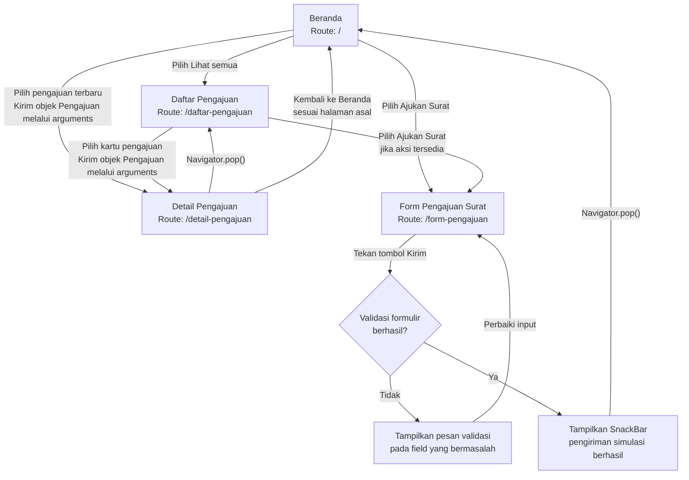

# Navigation Flow SIPORA

## 1. Tujuan

SIPORA (*Sistem Informasi Pengajuan Observasi dan Riset Akademik*) merupakan aplikasi yang dirancang untuk membantu mahasiswa mengakses informasi pengajuan surat observasi dan penelitian akademik.

Navigation flow ini menjelaskan hubungan antarlayar yang mendukung mahasiswa untuk melihat ringkasan pengajuan, menelusuri daftar pengajuan, melihat detail pengajuan yang dipilih, dan mengisi formulir pengajuan surat. Rancangan ini melanjutkan desain antarmuka pada Tugas 5 dengan menerapkan named routes, pengiriman data antarlayar, validasi formulir, dan umpan balik melalui `SnackBar` sesuai materi Pertemuan 6.

Pada tahap ini, pengiriman formulir masih berupa simulasi. Aplikasi belum melakukan penyimpanan permanen maupun memperbarui daftar pengajuan secara otomatis setelah formulir dikirim.

## 2. Daftar Route

| Nama route          | Layar                | Kebutuhan yang dipenuhi                                                                                                                                 | `initialRoute` |
| ------------------- | -------------------- | ------------------------------------------------------------------------------------------------------------------------------------------------------- | -------------- |
| `/`                 | Beranda              | Mahasiswa dapat melihat ringkasan jumlah dan status pengajuan, pengajuan terbaru, serta akses untuk mengajukan surat atau membuka daftar pengajuan.     | Ya             |
| `/daftar-pengajuan` | Daftar Pengajuan     | Mahasiswa dapat melihat daftar pengajuan surat observasi dan penelitian beserta instansi tujuan, tanggal, dan statusnya.                                | Tidak          |
| `/detail-pengajuan` | Detail Pengajuan     | Mahasiswa dapat melihat informasi lebih lengkap dari pengajuan yang dipilih pada daftar atau Beranda. Data pengajuan dikirim melalui `arguments`.       | Tidak          |
| `/form-pengajuan`   | Form Pengajuan Surat | Mahasiswa dapat mengisi data pengajuan surat observasi atau penelitian, memperoleh pesan validasi, dan melihat umpan balik setelah pengiriman simulasi. | Tidak          |

**Catatan kebutuhan:** kolom kebutuhan di atas menjelaskan fungsi layar berdasarkan rancangan SIPORA. Sebelum pengumpulan, tambahkan ID kebutuhan yang sesuai dengan `dokumen-kebutuhan.md` Tugas 4–5 apabila kebutuhan tersebut telah diberi ID. Jangan menetapkan ID baru tanpa mencocokkannya dengan dokumen sebelumnya.

## 3. Diagram Navigation Flow

## 4. Penjelasan Alur

### 4.1 Beranda

Beranda menjadi titik awal aplikasi. Sesuai desain Tugas 5, layar ini menampilkan identitas mahasiswa, ringkasan jumlah pengajuan, statistik status, pengajuan terbaru, dan tombol **Ajukan Surat**.

Mahasiswa dapat membuka daftar pengajuan melalui tindakan **Lihat semua** atau memilih salah satu pengajuan terbaru untuk melihat detailnya. Tombol Ajukan Surat membuka formulir pengajuan.

### 4.2 Daftar Pengajuan

Layar Daftar Pengajuan menampilkan seluruh data pengajuan yang tersedia pada aplikasi. Setiap item menampilkan informasi utama seperti jenis surat, instansi tujuan, tanggal pengajuan, dan status.

Ketika mahasiswa memilih salah satu item, aplikasi meneruskan objek `Pengajuan` ke layar Detail Pengajuan menggunakan `Navigator.pushNamed` dengan parameter `arguments`. Tombol kembali pada layar detail mengembalikan mahasiswa ke layar sebelumnya.

### 4.3 Detail Pengajuan

Layar Detail Pengajuan menampilkan informasi berdasarkan objek pengajuan yang dipilih, bukan menggunakan data tetap yang tidak berhubungan dengan item pada daftar.

Objek yang diteruskan mengikuti model `Pengajuan` pada kode Tugas 5, dengan properti:

* `jenis`: jenis surat yang diajukan.
* `instansi`: nama instansi tujuan.
* `tanggal`: informasi tanggal yang ditampilkan pada data pengajuan.
* `status`: status pengajuan yang ditampilkan.

Ketika menerima `arguments`, implementasi harus memeriksa tipe data yang diterima menggunakan `is` dan menangani kondisi `null` atau tipe yang tidak sesuai. Jika data tidak tersedia, layar menampilkan informasi yang sesuai dan tidak memaksakan akses ke objek yang tidak valid.

### 4.4 Form Pengajuan Surat

Mahasiswa dapat membuka formulir melalui tombol Ajukan Surat. Formulir menyediakan field yang diperlukan untuk pengajuan surat observasi atau penelitian sesuai kebutuhan yang ditetapkan pada tugas sebelumnya.

Setiap field wajib memiliki validator. Ketika mahasiswa menekan tombol Kirim, aplikasi memanggil `FormState.validate()` untuk memeriksa isian.

* **Jika validasi gagal:** pesan kesalahan ditampilkan pada field terkait dan mahasiswa tetap berada di layar formulir.
* **Jika validasi berhasil:** aplikasi menampilkan `SnackBar` yang menjelaskan bahwa pengiriman masih berupa simulasi. Setelah umpan balik ditampilkan, aplikasi menutup layar formulir dengan `Navigator.pop(context)`.

Pada implementasi Tugas 6, aksi tersebut tidak boleh dinyatakan sebagai persetujuan petugas atau bukti bahwa surat telah diproses. Data belum disimpan secara permanen dan daftar pengajuan tidak otomatis memperoleh item baru.

## 5. Alasan Pemilihan `initialRoute`

Route `/` dipilih sebagai `initialRoute` karena Beranda merupakan titik awal yang sesuai dengan rancangan Tugas 5. Beranda memberikan akses langsung ke ringkasan status pengajuan, daftar pengajuan, detail pengajuan terbaru, dan tindakan untuk memulai pengajuan surat sehingga mahasiswa dapat menentukan langkah berikutnya dari satu layar awal.

## 6. Aturan Navigasi dan Pengiriman Data

### 6.1 Navigasi maju

Navigasi dari satu layar ke layar lain menggunakan `Navigator.pushNamed`. Nama route yang digunakan dalam implementasi harus sama persis dengan nama route pada tabel dan diagram.

### 6.2 Navigasi kembali

Navigasi kembali dari layar turunan menggunakan `Navigator.pop(context)`. Beranda sebagai route awal tidak perlu diberi tombol kembali manual yang memanggil `pop` tanpa pemeriksaan, karena tidak memiliki halaman sebelumnya dalam alur aplikasi ini.

Untuk layar Detail Pengajuan, aksi kembali harus mengembalikan pengguna ke layar asal apabila detail dibuka dari Beranda atau Daftar Pengajuan.

### 6.3 Pengiriman data

Data pengajuan diteruskan dari Beranda atau Daftar Pengajuan ke Detail Pengajuan melalui `arguments`. Implementasi perlu memeriksa tipe dan keberadaan data sebelum menampilkannya.

Form Pengajuan tidak memerlukan `arguments` untuk menampilkan detail pengajuan yang dipilih. Formulir menggunakan isian pengguna dan memvalidasinya sebelum memberikan umpan balik pengiriman simulasi.

### 6.4 Validasi dan feedback

Setiap field formulir harus memiliki validator yang relevan dengan data yang diminta. Untuk field wajib, validator memeriksa apakah nilai kosong atau hanya berisi spasi. Pesan validasi harus jelas agar mahasiswa mengetahui bagian yang perlu diperbaiki.

Setelah semua validasi berhasil, `SnackBar` memberikan informasi bahwa pengiriman telah disimulasikan. Controller untuk field formulir dikelola pada layar yang sesuai dan dibersihkan melalui `dispose()`.

### 6.5 Batasan implementasi

Cakupan Tugas 6 adalah navigasi dan interaksi dasar. Penyimpanan permanen, pengelolaan data berbasis database, dan pembaruan daftar pengajuan setelah pengiriman belum menjadi bagian dari implementasi ini.

## 7. Pemeriksaan Konsistensi

Pemeriksaan konsistensi dilakukan untuk memastikan dokumentasi navigasi, rancangan antarmuka, dan implementasi SIPORA telah sesuai dengan kebutuhan pengguna serta ketentuan tugas.

- [x] Semua layar dan alur navigasi sesuai dengan rancangan Information Architecture (IA) Tugas 5.
- [x] ID kebutuhan telah dicocokkan dengan dokumen kebutuhan Tugas 4–5.
- [x] Diagram navigasi sesuai dengan nama layar dan mekanisme navigasi yang digunakan dalam kode.
- [x] Tombol **Ajukan Surat** pada Beranda membuka halaman formulir pengajuan.
- [x] Navigasi maju menggunakan `Navigator.push` dan `MaterialPageRoute`.
- [x] Pengguna dapat kembali dari formulir ke Beranda melalui mekanisme navigasi kembali yang tersedia.
- [x] Formulir membedakan pengajuan penelitian skripsi dan observasi sesuai kebutuhan.
- [x] Pengajuan observasi mendukung pengisian data lebih dari satu anggota ketika jenis pengajuan berkelompok dipilih.
- [x] Semua field wajib memiliki validator sesuai kebutuhan, termasuk validasi bersyarat untuk field tertentu.
- [x] Controller input teks dibersihkan melalui `dispose()`.
- [x] Pesan validasi ditampilkan ketika data wajib belum lengkap.
- [x] Ringkasan konfirmasi ditampilkan setelah data pengajuan lolos validasi.
- [x] `SnackBar` memberikan umpan balik setelah interaksi pengiriman simulasi yang valid.
- [x] Aplikasi tidak menyatakan data tersimpan secara permanen atau surat telah disetujui.
- [x] Diagram navigasi telah dibandingkan dengan alur aplikasi yang dijalankan dan diuji.

### Catatan Implementasi

Navigasi SIPORA menggunakan `Navigator.push` dengan `MaterialPageRoute` untuk membuka formulir pengajuan dari Beranda. Mekanisme ini sesuai dengan implementasi aplikasi saat ini. Penggunaan `MaterialApp.routes`, `initialRoute`, `Navigator.pushNamed`, dan `arguments` tidak dijadikan persyaratan pada dokumentasi ini karena tidak digunakan dalam alur navigasi yang dideskripsikan.
