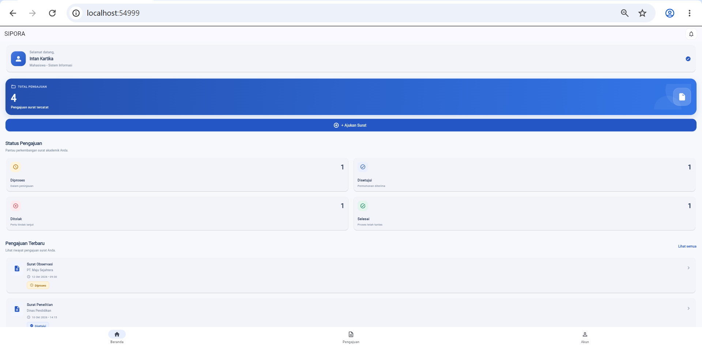
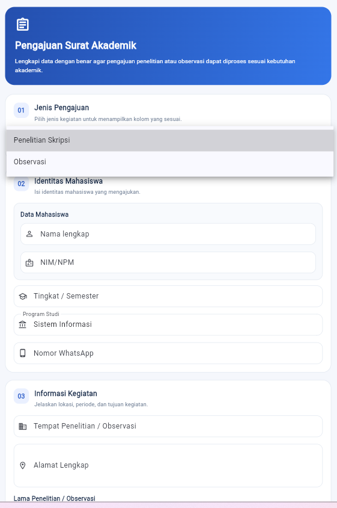
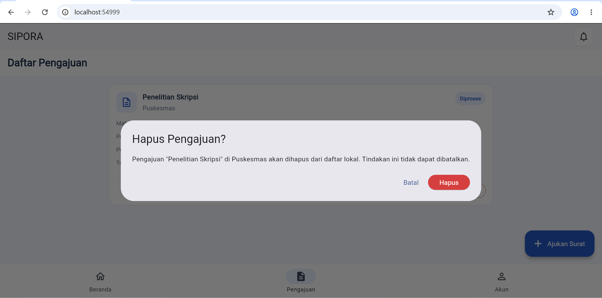

# Laporan Progress Project UTS (Milestone M4)

| **Identitas** | **Keterangan** |
|:---|:---|
| **Nama** | Intan Kartika |
| **NIM** | 230660221018 |
| **Kelas** | SI-VIIB |
| **Domain SI** | Layanan Administrasi Akademik |
| **Judul Aplikasi** | SIPORA (Sistem Informasi Pengajuan Surat Observasi dan Riset Akademik) |
| **Tautan Repository** | [Masukkan URL repository GitHub kelas] |

---

## 1. Ringkasan Eksekutif Project

SIPORA merupakan aplikasi mobile yang dirancang untuk mempermudah mahasiswa dalam mengajukan surat observasi dan riset akademik kepada pihak fakultas. Sebelumnya, proses pengajuan surat berpotensi membutuhkan waktu karena mahasiswa harus mengurus administrasi secara langsung dan memantau perkembangan pengajuan secara terpisah.

Aplikasi ini ditujukan untuk mahasiswa sebagai pengguna utama dan petugas fakultas sebagai pengelola pengajuan. Solusi mobile dipilih agar mahasiswa dapat memilih jenis surat, mengisi formulir, mengirim persyaratan, serta memantau status pengajuan melalui smartphone dengan lebih praktis. 

## 2. Ketercapaian Milestone (M1 s.d. M3)

| Milestone | Deliverable | Status | Catatan / Bukti |
|:---|:---|:---:|:---|
| M1: Kebutuhan | Dokumen kebutuhan dan User Flow | Selesai | `kebutuhan.md` pada Tugas 4 |
| M2: UI/UX | Wireframe dan Navigasi | Selesai | Prototype UI/UX Tugas 5 dan `navigation-flow.md` Tugas 6 |
| M3: MVP Awal | Model data dan CRUD lokal | Sebagian | `model-data.md` dan `crud-lokal.dart` pada Tugas 7; fitur Update dan Delete masih perlu dilengkapi. |

## 3. Matriks Kebutuhan ke Implementasi

| ID Kebutuhan | Deskripsi Kebutuhan | Prioritas MoSCoW | Halaman Pemenuh | Operasi Data Terkait |
|:---:|:---|:---:|:---|:---:|
| F-01 | Memilih jenis surat | Must | Halaman Daftar Surat | Read |
| F-02 | Mengisi data pengajuan | Must | Halaman Form Pengajuan | Create |
| F-03 | Mengunggah dokumen pendukung | Must | Halaman Form Pengajuan | Create |
| F-04 | Mengirim pengajuan surat | Must | Halaman Form Pengajuan | Create |
| F-05 | Melihat status pengajuan | Must | Halaman Status Pengajuan | Read |

Kebutuhan tersebut menjadi dasar perancangan halaman dan pengelolaan data SIPORA. Pada tahap MVP, pengelolaan data lokal masih menjadi fokus utama, sedangkan beberapa fungsi seperti unggah dokumen dan pengelolaan pengajuan secara menyeluruh masih memerlukan pengembangan lanjutan.

## 4. Tangkapan Layar Aplikasi Berjalan

Berikut tangkapan layar yang perlu disertakan sebagai bukti implementasi aplikasi SIPORA.

| No. | File Gambar | Keterangan |
|:---:|:---|:---|
| 1 |  | Tampilan halaman utama atau daftar pengajuan SIPORA. |
| 2 |  | Tampilan formulir pengajuan beserta validasi input. |
| 3 |  | Dialog konfirmasi tindakan penghapusan data. |

*Letakkan ketiga file gambar tersebut di folder `tugas-8/` dan pastikan tangkapan layar berasal dari aplikasi yang benar-benar dijalankan. Jika fitur hapus belum selesai, selesaikan implementasinya terlebih dahulu sebelum mengambil screenshot konfirmasi penghapusan.*

## 5. Kendala dan Solusi Teknis

| No. | Kendala | Cara Mengatasinya |
|:---:|:---|:---|
| 1 | Pengaturan navigasi antarhalaman masih menggunakan perpindahan halaman secara langsung sehingga belum sesuai dengan ketentuan named routes. | Menyesuaikan navigasi menggunakan `initialRoute`, `routes`, `pushNamed()`, dan `pop()` agar perpindahan halaman lebih terstruktur. |
| 2 | Pengelolaan data pengajuan lokal belum mencakup seluruh operasi CRUD, terutama Update dan Delete. | Menggunakan ID sebagai identitas unik data, `indexWhere()` untuk mencari data, serta `removeWhere()` untuk menghapus data berdasarkan ID. |

## 6. Rencana Pengembangan Milestone M5 (REST API)

Pada Milestone M5, SIPORA akan dikembangkan dengan mengintegrasikan REST API agar data pengajuan tidak hanya tersimpan sementara di perangkat. Data yang direncanakan untuk diakses meliputi daftar jenis surat, data mahasiswa, informasi pengajuan, status pengajuan, dan dokumen pendukung.

Backend yang dibutuhkan meliputi layanan autentikasi pengguna, pengelolaan data pengajuan, pembaruan status oleh petugas fakultas, serta penyimpanan dokumen. Integrasi ini diharapkan membuat data mahasiswa dan petugas dapat dikelola secara terpusat.

## 7. Refleksi Pembelajaran Tengah Semester

Melalui pengerjaan SIPORA, saya memahami bahwa pengembangan aplikasi Flutter tidak hanya berfokus pada tampilan, tetapi juga membutuhkan perencanaan kebutuhan, navigasi, model data, dan pengelolaan state. Saya juga mempelajari penggunaan `setState()` untuk memperbarui tampilan ketika data berubah serta penerapan CRUD dalam penyimpanan lokal. Tantangan yang dihadapi adalah menghubungkan setiap halaman dan memastikan pengelolaan data berjalan sesuai alur aplikasi. Pembelajaran ini menjadi dasar untuk mengembangkan SIPORA lebih lanjut melalui integrasi REST API pada pertemuan berikutnya.

## 8. Deklarasi Penggunaan AI

Deklarasi penggunaan AI: ChatGPT — membantu memahami materi Flutter, meninjau struktur kode dan navigasi, mengidentifikasi kendala implementasi, serta menyusun dokumentasi project. Proses penyesuaian kode, pengujian aplikasi, dan verifikasi hasil implementasi tetap dilakukan oleh penulis.