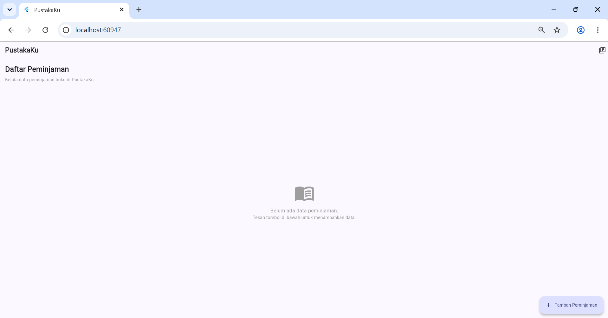
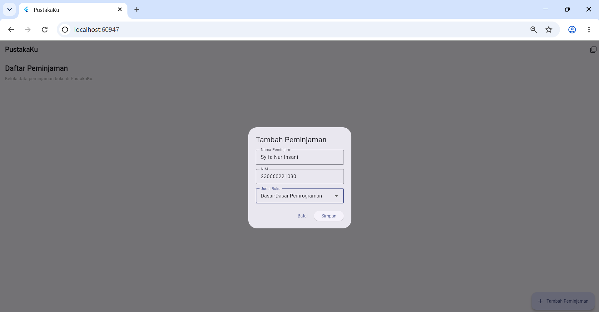
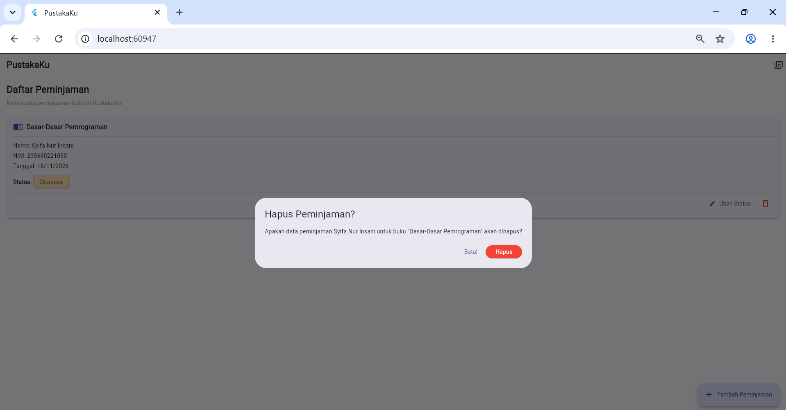

# Laporan Progress UTS — PustakaKu

## Identitas Mahasiswa

| Keterangan | Data |
|---|---|
| Nama | Syifa Nur Insani |
| NIM | 230660221030 |
| Kelas | SI-VIIB |
| Mata Kuliah | Pemrograman Aplikasi Bergerak |
| Nama Aplikasi | PustakaKu |
| Domain | Aplikasi Perpustakaan Kampus |

---

## 1. Executive Summary

PustakaKu merupakan aplikasi perpustakaan kampus yang dirancang untuk membantu mahasiswa melihat katalog buku, mengetahui informasi dan ketersediaan buku, serta mengajukan peminjaman dan memantau status peminjaman. Aplikasi ini dikembangkan menggunakan Flutter dan bahasa pemrograman Dart.

Pengembangan PustakaKu dilakukan secara bertahap, dimulai dari identifikasi kebutuhan aplikasi, pemrograman dasar Dart, pembuatan antarmuka menggunakan widget Flutter, analisis kebutuhan dan user flow, perancangan UI/UX, implementasi navigasi dan interaksi form, hingga pengelolaan data menggunakan operasi CRUD lokal.

Pada tahap UTS, implementasi dari beberapa tugas telah diintegrasikan ke dalam satu aplikasi. Halaman utama menggunakan fitur pengelolaan data peminjaman dari Tugas 7, sedangkan halaman katalog buku telah diintegrasikan dengan data buku yang digunakan pada Tugas 6–7.

Aplikasi saat ini telah mendukung proses penambahan, penampilan, perubahan status, dan penghapusan data peminjaman. Selain itu, katalog dapat menampilkan empat buku beserta informasi penulis, jumlah stok, dan status ketersediaannya. Penyimpanan data masih menggunakan List pada memori aplikasi sehingga belum bersifat permanen.

## 2. Progress Pencapaian Milestone

| Tahap | Kegiatan | Hasil Pengerjaan | Status |
|---|---|---|---|
| M1 | Identifikasi kebutuhan aplikasi | Menentukan permasalahan, pengguna, fitur, dan domain aplikasi PustakaKu pada Tugas 1. | Selesai |
| M1 | Dasar pemrograman Dart | Membuat program perhitungan nilai menggunakan variabel, fungsi, perulangan, kondisi, dan koleksi data pada Tugas 2. | Selesai |
| M1 | Struktur Flutter dan widget | Membuat halaman katalog buku menggunakan widget Flutter pada Tugas 3. | Selesai |
| M2 | Analisis kebutuhan dan user flow | Menyusun persona, kebutuhan fungsional dan nonfungsional, prioritas fitur, serta diagram user flow pada Tugas 4. | Selesai |
| M2 | Perancangan UI/UX | Menyusun information architecture, wireframe, catatan keputusan UI, dan dokumentasi prototype pada Tugas 5. | Selesai secara dokumentasi |
| M3 | Navigasi dan interaksi | Mengimplementasikan navigasi antarlayar, interaksi form, dan feedback menggunakan Flutter pada Tugas 6. | Selesai |
| M3 | Model data dan CRUD lokal | Membuat model Peminjaman dan operasi Create, Read, Update, Delete menggunakan List dan setState() pada Tugas 7. | Selesai |
| Integrasi | Penggabungan fitur aplikasi | Mengintegrasikan halaman daftar peminjaman dan katalog buku dalam satu aplikasi PustakaKu. | Selesai |
| Pengujian | Pengujian fitur dan analisis kode | Menguji navigasi, pemilihan buku berdasarkan stok, dan operasi CRUD serta menjalankan flutter analyze. | Selesai |

### Catatan Progress

Beberapa hal yang perlu diperhatikan pada hasil pengembangan saat ini:

1. File `halaman-utama.dart` masih tersedia sebagai hasil pengerjaan sebelumnya, tetapi bukan halaman utama yang dijalankan pada aplikasi akhir. Aplikasi saat ini menggunakan `main.dart` yang mengarahkan pengguna ke `DaftarPeminjamanScreen` dalam `crud-lokal.dart`.
2. Halaman katalog telah terintegrasi, tetapi belum memiliki fitur pencarian dan halaman detail buku pada implementasi yang aktif.
3. Penyimpanan data peminjaman masih menggunakan metode in-memory. Data akan kembali kosong ketika aplikasi dimulai ulang.
4. Hasil `flutter analyze` menunjukkan tiga informasi terkait penamaan file, tanpa error. Informasi tersebut berkaitan dengan penggunaan tanda hubung pada nama file yang belum mengikuti standar `lower_case_with_underscores`.

## 3. Pemetaan Kebutuhan ke Implementasi

Pemetaan berikut mengacu pada kebutuhan fungsional yang telah disusun dalam dokumen Tugas 4.

| ID | Kebutuhan Fungsional | Rencana Halaman/Fitur | Progress Implementasi |
|---|---|---|---|
| F-01 | Mahasiswa dapat mencari buku berdasarkan judul atau kata kunci. | Halaman katalog dan kolom pencarian. | Belum tersedia pada halaman katalog yang aktif. |
| F-02 | Mahasiswa dapat melihat detail buku yang dipilih. | Halaman detail buku. | Belum diimplementasikan pada aplikasi akhir. |
| F-03 | Mahasiswa dapat melihat status ketersediaan buku. | Informasi stok dan status buku pada katalog. | Sudah diimplementasikan. |
| F-04 | Mahasiswa dapat mengajukan peminjaman buku yang tersedia. | Form peminjaman. | Sudah diimplementasikan melalui formulir dan penambahan data peminjaman. |
| F-05 | Mahasiswa dapat melihat status peminjaman yang telah diajukan. | Daftar dan status peminjaman. | Sudah diimplementasikan melalui halaman daftar peminjaman. |
| F-06 | Mahasiswa dapat melihat batas waktu pengembalian buku. | Informasi batas pengembalian. | Belum diimplementasikan. |
| F-07 | Petugas dapat menambahkan data buku ke katalog. | Halaman pengelolaan buku. | Belum diimplementasikan. |
| F-08 | Petugas dapat memperbarui status peminjaman mahasiswa. | Pengelolaan status peminjaman. | Sudah diimplementasikan melalui fitur Update status. |

### Ringkasan Pemetaan

Implementasi yang paling terlihat pada tahap ini adalah proses pengajuan dan pengelolaan data peminjaman. Model `Peminjaman` memiliki atribut ID, nama, NIM, judul buku, tanggal, dan status.

Pengelolaan data dilakukan menggunakan operasi CRUD, yaitu Create untuk menambahkan data peminjaman, Read untuk menampilkan data, Update untuk mengubah status peminjaman, dan Delete untuk menghapus data.

Selain itu, halaman katalog telah terintegrasi dengan daftar buku yang terdiri dari Dasar-Dasar Pemrograman, Pengembangan Aplikasi Flutter, Sistem Informasi Manajemen, dan Konsep Basis Data. Informasi stok digunakan untuk menentukan ketersediaan buku. Buku dengan stok 0 tidak ditampilkan sebagai pilihan pada formulir peminjaman.

Meskipun demikian, belum seluruh kebutuhan fungsional pada Tugas 4 telah diwujudkan dalam implementasi. Fitur pencarian, detail buku, batas waktu pengembalian, dan pengelolaan katalog oleh petugas masih memerlukan pengembangan.

## 4. Dokumentasi Screenshot

Dokumentasi berikut menunjukkan hasil implementasi aplikasi PustakaKu setelah integrasi fitur katalog dan CRUD peminjaman.

### 4.1 Halaman Daftar Peminjaman

Halaman daftar peminjaman merupakan halaman utama aplikasi PustakaKu. Halaman ini menampilkan data peminjaman yang telah ditambahkan serta menyediakan fitur untuk mengubah status dan menghapus data peminjaman.

### 4.2 Formulir Tambah Peminjaman

Formulir ini digunakan untuk memasukkan data peminjaman berupa identitas mahasiswa dan pilihan buku. Pilihan buku disesuaikan dengan ketersediaan stok sehingga buku yang stoknya habis tidak dapat dipilih.

### 4.3 Konfirmasi Penghapusan Data

Dialog konfirmasi ditampilkan sebelum data peminjaman dihapus. Fitur ini digunakan untuk menghindari penghapusan data secara tidak sengaja.

## 5. Kendala Teknis dan Solusi

### 5.1 Pengelolaan Navigasi Antarhalaman

**Kendala:**

Pada pengembangan aplikasi, diperlukan pengaturan navigasi agar pengguna dapat berpindah dari halaman utama menuju halaman katalog tanpa mengganggu fitur pengelolaan peminjaman yang telah dibuat sebelumnya.

**Solusi:**

Navigasi diimplementasikan menggunakan `Navigator.push()` dan `MaterialPageRoute`. Data daftar buku dikirimkan ke halaman katalog melalui parameter konstruktor sehingga halaman katalog dapat menggunakan sumber data buku yang sama dengan halaman peminjaman.

### 5.2 Pengelolaan Data dan Operasi CRUD

**Kendala:**

Pengelolaan data peminjaman membutuhkan identitas yang konsisten agar data dapat ditambahkan, ditampilkan, diperbarui, dan dihapus dengan benar. Perubahan status peminjaman juga harus diterapkan pada data yang tepat.

**Solusi:**

Dibuat model `Peminjaman` dengan atribut `id`, `nama`, `nim`, `judulBuku`, `tanggal`, dan `status`. Data dikelola menggunakan `List<Peminjaman>` pada `StatefulWidget`. Operasi Update dan Delete menggunakan ID sebagai identitas data, sedangkan `setState()` digunakan untuk memperbarui tampilan setelah terjadi perubahan.

### 5.3 Pengelolaan Ketersediaan Buku

**Kendala:**

Pilihan buku pada formulir peminjaman perlu disesuaikan dengan jumlah stok agar mahasiswa tidak dapat memilih buku yang sedang tidak tersedia.

**Solusi:**

Dibuat model `Buku` yang memiliki atribut judul, penulis, deskripsi, dan stok. Ketersediaan buku ditentukan berdasarkan jumlah stok. Daftar pilihan pada formulir menggunakan penyaringan data sehingga hanya buku dengan stok lebih dari 0 yang dapat dipilih.

### 5.4 Keterbatasan Penyimpanan Data

**Kendala:**

Data peminjaman pada tahap ini masih disimpan dalam memori aplikasi sehingga data tidak bertahan setelah aplikasi dimulai ulang.

**Solusi dan Pengembangan:**

Pada tahap berikutnya, penyimpanan data akan dikembangkan menggunakan database lokal atau REST API agar data dapat disimpan secara lebih terstruktur dan tidak hanya tersedia selama aplikasi berjalan.

## 6. Rencana Pengembangan M5 — Integrasi REST API

Pada tahap pengembangan berikutnya, PustakaKu direncanakan menggunakan REST API untuk menghubungkan aplikasi Flutter dengan backend Sistem Informasi Perpustakaan.

Rencana pengembangan meliputi:

1. **Menyiapkan backend dan database:** Menyediakan layanan backend dan database untuk menyimpan data buku serta peminjaman.
2. **Membuat endpoint katalog:** Menyediakan endpoint untuk mengambil daftar buku, mencari buku, dan melihat detail serta ketersediaan buku.
3. **Membuat endpoint peminjaman:** Menyediakan endpoint untuk mengirim pengajuan peminjaman dan mengambil informasi status peminjaman.
4. **Mengintegrasikan Flutter dengan REST API:** Menghubungkan aplikasi Flutter ke backend menggunakan HTTP request dan response.
5. **Menangani respons dan kesalahan:** Menambahkan penanganan kondisi loading, data kosong, koneksi gagal, dan respons server yang tidak sesuai.
6. **Menguji integrasi:** Memastikan proses pengambilan data katalog dan pengajuan peminjaman dapat berjalan sesuai kebutuhan.

Integrasi REST API diharapkan dapat membuat PustakaKu menggunakan data yang terpusat sehingga informasi buku dan peminjaman dapat dikelola secara lebih konsisten.

## 7. Refleksi Pembelajaran

Selama mengerjakan proyek PustakaKu dari Tugas 1 sampai Tugas 7, saya memahami bahwa pengembangan aplikasi mobile perlu dilakukan secara bertahap, mulai dari analisis kebutuhan, perancangan antarmuka, navigasi, hingga pengelolaan data.

Saya juga memperoleh pemahaman mengenai penggunaan widget Flutter, navigasi menggunakan Navigator, validasi form, serta penerapan operasi CRUD menggunakan List dan setState(). Pada tahap integrasi, saya memahami pentingnya penggunaan model data yang konsisten agar fitur katalog dan peminjaman dapat saling terhubung.

Tantangan yang dihadapi selama proses pengembangan membuat saya menyadari pentingnya kesesuaian antara kebutuhan, rancangan, dan implementasi aplikasi. Pengembangan selanjutnya perlu difokuskan pada penyempurnaan fitur yang belum tersedia serta penerapan penyimpanan data agar aplikasi dapat digunakan secara lebih optimal.
